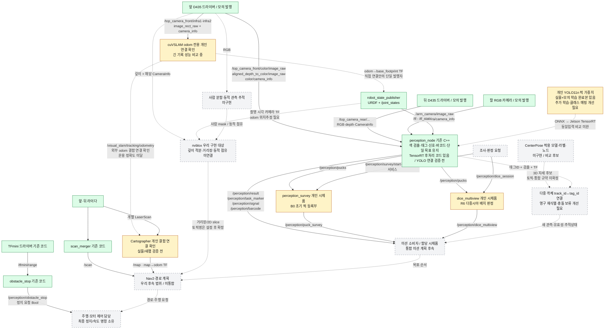

# 인지·위치추정·지도·후속 계획 구성

2026-10-29 현재 코드를 확인한 구조다. **코드가 있음은 현재 장비에서 모두 실행·검증됐다는 뜻이 아니다.** 초록은 기존 코드/별도 모의 실행, 노랑은 개인 시제품·개선 중, 점선/회색은 통합 또는 구현 전이다. nvblox는 담당 범위에 포함하며, Nav2·경로·미션 계획은 이후 시간이 남으면 진행한다. 실제 모터 제어 구현은 제외한다.

## 그림을 읽을 때 주의

- 기존perception기본설정은engine_path가비어있어색검출기다. 개인R6빌드는WITH_TENSORRT=OFF. YOLO실물·모의학습/CPU추론이있다는것과Jetson ROS실행완료는구분한다.
- /perception/set_mode·/perception/check_dice는기존서비스다. /perception/dice_session·dice_multiview는개인별도시제품이며기존서비스와통합한것이아니다.
- 앞뒤라이다는Cartographer에각각넣는기존비교설정(num_laser_scans=2)이있다. scan_merger출력/scan이실제Nav2/안전최종명령에연결돼있다는뜻은아니다.
- obstacle_stop은TFmini입력이다. 모든방향/높이의라이다·깊이안전감시로완성된노드가아니다.
- cuVSLAM과Cartographer는기존옛맵의별도시험이있고개인결합연결도확인했다. 밝은긴기록에서결합RMSE0.293m로기준미달이며새발제맵/실물은미검증이다. TF map→odom은Cartographer, odom→차체는cuVSLAM또는융합EKF중하나만발행하도록구성해야한다.
- nvblox의TF입력은RSP만으로완성되지않고VO/SLAM위치추정과센서외부보정이함께필요하다. 깊이토픽·해상도·K·단위·시각을검증한후실제노드/토픽명을확정한다.
- 새모델261029_1030은사용자확인상아직만들지않았다. 지금그림/시험은기존모델기준이다.
